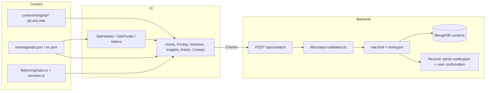

## Descrição

Implementar no site real o redesign aprovado em protótipo (`.temp/betacode-website/`): homepage, calculadora de preços, Betacode Ventures, Insights, 7 artigos e contacto, em PT/EN e light/dark, com a interface igual ao HTML do protótipo. Segue `IMPLEMENTATION.md` e `AGENT_PROMPT.md` do pacote.

Decisões: manter a stack atual (Next.js App Router, next-intl, next-themes, MongoDB, Resend); calculadora igual ao protótipo (5 passos, sem pergunta de dimensão) com "voltar apaga a resposta"; artigos em MDX; anti-spam com honeypot e rate limit.

## Objetivo

Publicar as 12 páginas do redesign com o mesmo design, copy, comportamento e estados do protótipo, com os três formulários ligados ao backend.

## Critérios de aceitação

- As 12 páginas existem em `/pt` e `/en` com copy idêntica ao protótipo.
- Light e dark em todas as páginas, sem flash ao carregar.
- Cabeçalho e rodapé idênticos em todas as páginas.
- Os três formulários gravam o contacto, notificam a equipa e enviam confirmação ao utilizador.
- Pontos em aberto do §10 assinalados com `TODO(betacode):`.

## Arquitetura

